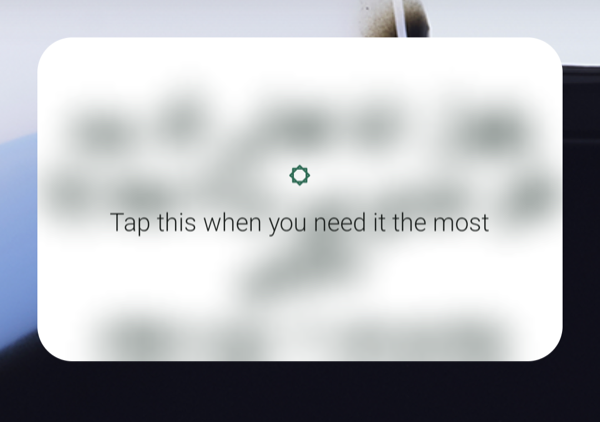
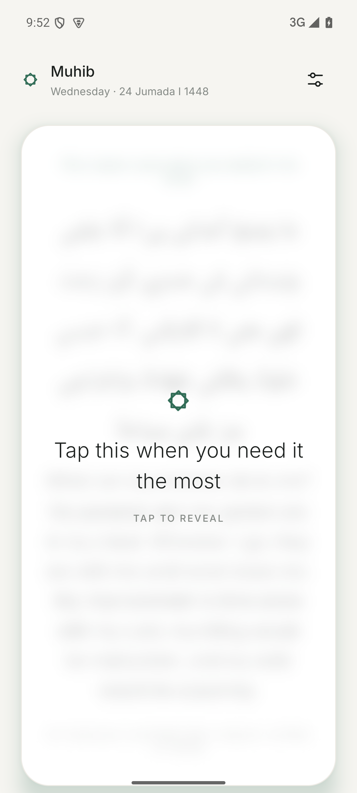
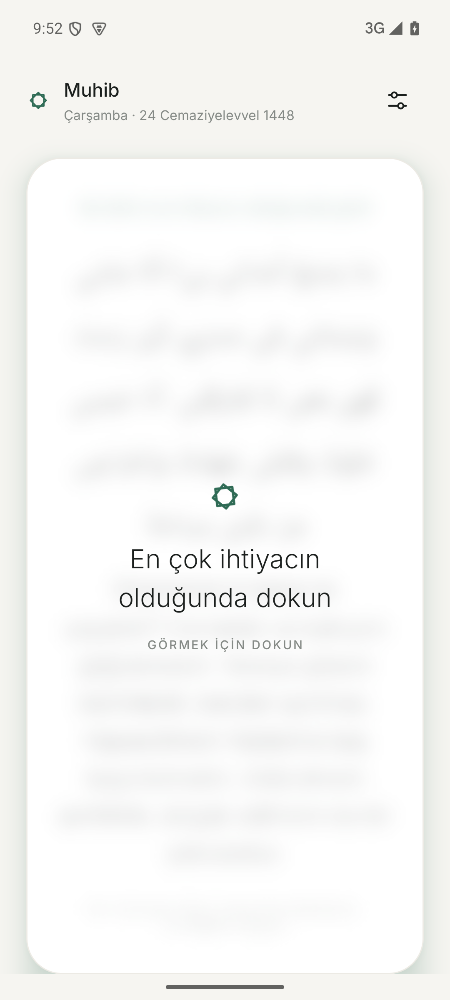
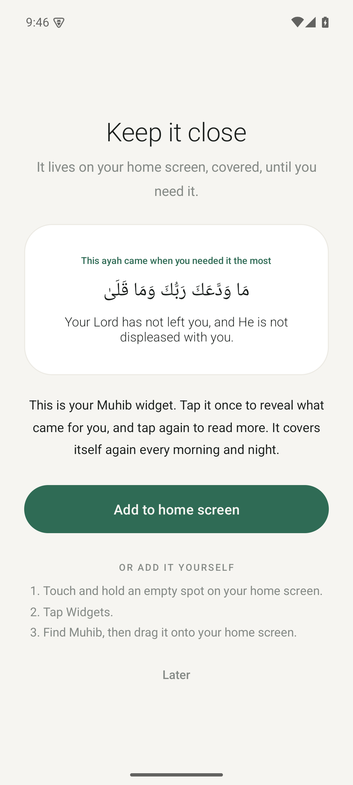
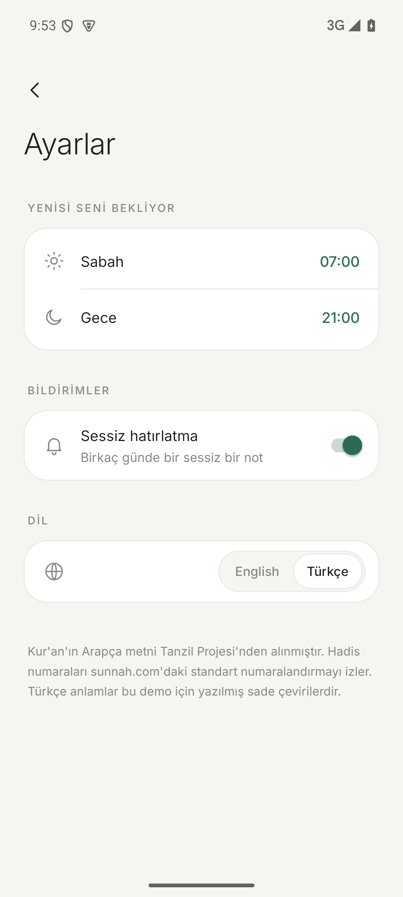

# Muhib · مُحِبّ

A minimalist Islamic home-screen widget for Android. It stays blurred with *"Tap this when you need it the most"*. Tap once and an ayah, hadith, sunnah or a passage from a scholar is revealed in place. Tap again to open the app and read a little more, with the source.

<p>
  
  
</p>
<p>
  
  
  
  
</p>

## How it behaves
- Every morning and night (7:00 and 21:00 by default) the widget quietly covers itself again with a new pick. Every reminder appears once before any repeat.
- A silent notification ("Something is waiting for you.") goes out at most once every 3–5 days. It can be turned off in Settings.
- First launch shows a short welcome that helps place the widget on the home screen.
- English and Turkish. The app follows the phone's language until the user picks one in Settings.
- No account, no internet use, no ads.

## Content
All reminders live in [`app/src/main/assets/content.json`](app/src/main/assets/content.json). Each item has `id`, `type` (ayah / hadith / sunnah / chapter), `arabic`, `text`, `source`, `more` (the "a little more" note), and optional `link` and `headline`. A `tr` object holds the Turkish `text`, `source`, `more` and optional `headline`.

- Qur'an Arabic text is from the [Tanzil Project](https://tanzil.net).
- Hadith references follow the standard numbering used on sunnah.com.
- The English and Turkish meanings and notes in this demo are simple renderings and should be reviewed before wider use.

## Building
Requires JDK 17 and the Android SDK (platform 35).

```bash
./gradlew assembleRelease
```

The APK lands in `app/build/outputs/apk/release/`. Release builds are signed with the key described in a local `keystore.properties` (not committed):

```properties
storeFile=keystore/your-key.jks
storePassword=...
keyAlias=...
keyPassword=...
```

Without that file, release builds fall back to the debug key.

## Licenses
The Inter typeface is used under the SIL Open Font License; see [`licenses/Inter-OFL.txt`](licenses/Inter-OFL.txt).
